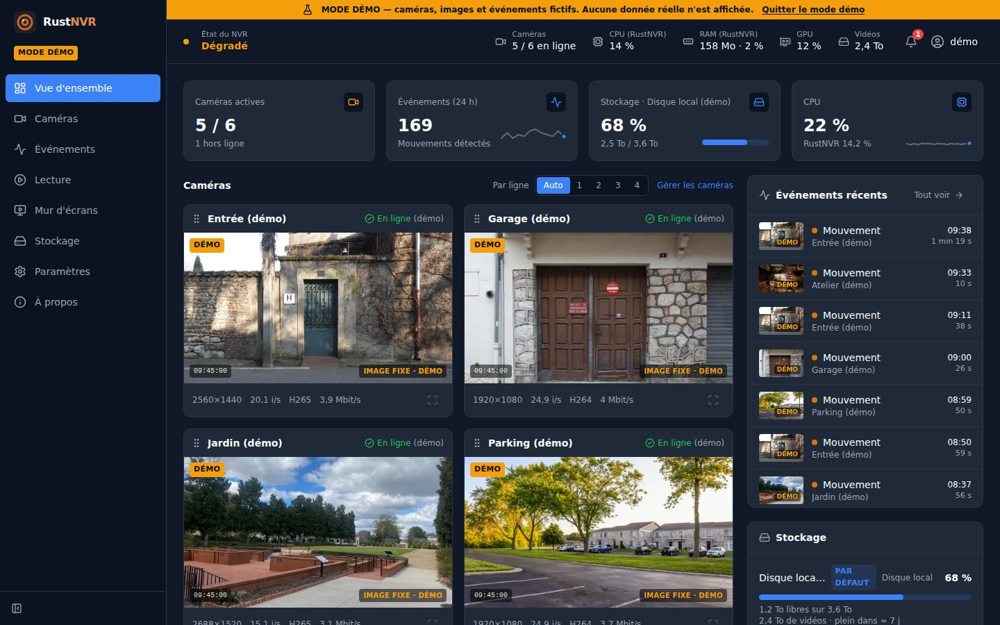
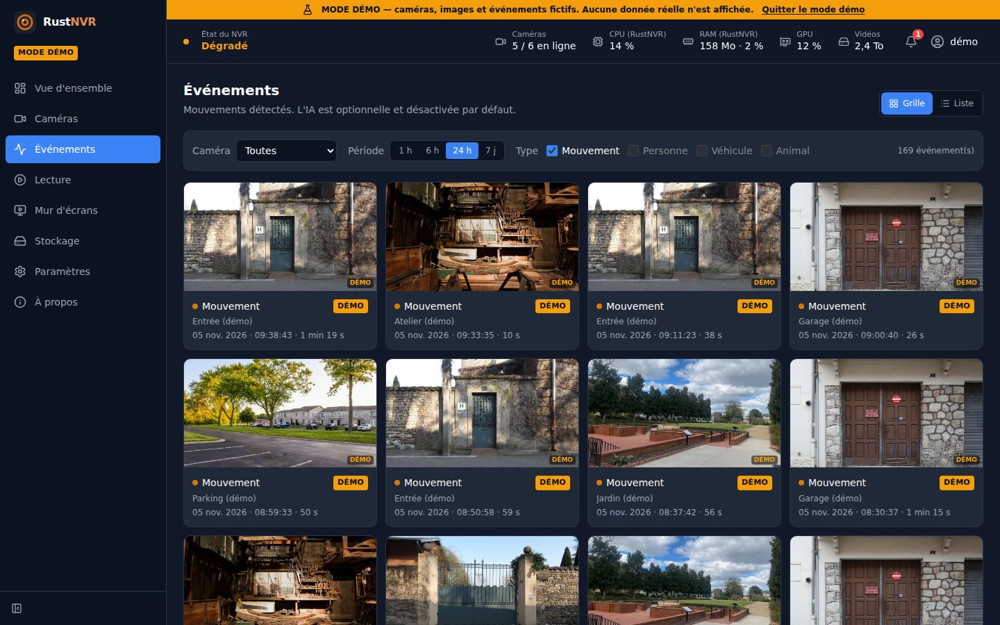
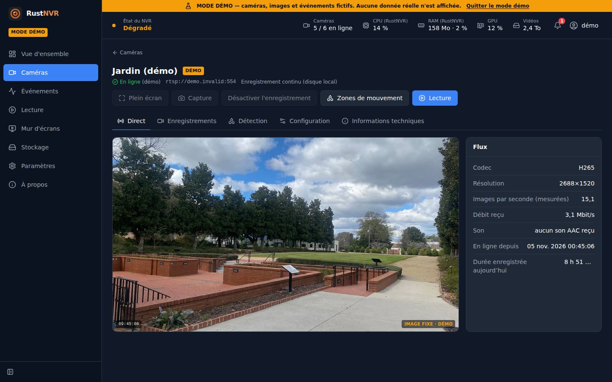

# RustNVR


[English](README.md) · **Français**

Enregistreur vidéo réseau (NVR) open source en Rust, conçu pour une faible
consommation CPU/RAM : les flux H.264/H.265 des caméras IP sont reçus en RTSP
et enregistrés **sans décodage ni réencodage** dans des segments MP4 fragmentés.

**[Démo en ligne](https://guiyomee.github.io/RustNVR/)** : l'interface avec des
caméras et des événements fictifs, sans rien installer.

<a href='https://ko-fi.com/Q4Z62AA835' target='_blank'></a>



| Événements | Une caméra |
|---|---|
|  |  |

## Pourquoi RustNVR

- **Léger** : un seul programme, la vidéo n'est jamais décodée pour être
  enregistrée. Face à Frigate sur la même machine, avec les mêmes caméras :
  13 fois moins de mémoire, 2,7 fois moins de processeur (voir plus bas).
- **Tout se règle dans l'interface** : caméras (recherche sur le réseau, test
  de connexion avec aperçu en direct), stockage, détection, IA, MQTT, comptes,
  sauvegarde.
- **Vos disques** : disque local, NAS (SMB, NFS), S3 ou SFTP, au choix par
  caméra, avec une rétention par destination et un repli sur le disque local
  quand le NAS manque.
- **Home Assistant** par MQTT, sans intégration à installer : mouvement,
  objets reconnus, état, enregistrement, dernière image, position PTZ.
- **Où vous voulez** : Docker, conteneur LXC Proxmox en une commande, ou
  service sur Debian / Ubuntu.

## Installation

**Docker** (image `ghcr.io/guiyomee/rustnvr`, Linux x86-64) :

```sh
mkdir rustnvr && cd rustnvr
curl -fsSLO https://raw.githubusercontent.com/Guiyomee/RustNVR/main/compose.yaml
echo 'RUSTNVR_WEB_PASSWORD=un-mot-de-passe-solide' > .env && chmod 600 .env
docker compose up -d
```

**Proxmox VE** (conteneur LXC, depuis le shell de l'hôte ; un menu propose
tous les réglages) :

```sh
bash -c "$(curl -fsSL https://raw.githubusercontent.com/Guiyomee/RustNVR/main/packaging/proxmox/rustnvr-lxc.sh)"
```

**Debian / Ubuntu** (service systemd) :

```sh
sudo apt install curl ffmpeg
curl -fsSLO https://raw.githubusercontent.com/Guiyomee/RustNVR/main/packaging/install.sh
sudo bash install.sh
```

Puis `https://<serveur>:8080/`, compte `admin`. Détails :
[Docker](docs/DOCKER.md) · [Installation et Proxmox](docs/INSTALLATION.md).

## Fonctions

- Enregistrement continu ou sur mouvement (avec les secondes d'avant),
  H.264 et H.265, son AAC et G.711 ; écriture sûre et réparation automatique
  après une coupure.
- Direct dans le navigateur (≈ 0,5 s de retard), mur d'écrans, relecture avec
  timeline et plusieurs caméras synchronisées, exports MP4.
- Détection de mouvement avec zones, reconnaissance d'objets optionnelle
  (YOLOX intégré, ou DeepStack / CodeProject.AI), plus exigeante la nuit si
  on le souhaite.
- Caméras motorisées (ONVIF PTZ), webcams USB, conversion sur la carte
  graphique (VAAPI, NVENC) pour les navigateurs sans H.265.
- Comptes administrateur / lecteur, HTTPS intégré, webhooks, API REST,
  vérification des nouvelles versions.

Liste détaillée, avec ce qui est vérifié et ce qui ne l'est pas :
[docs/FONCTIONNALITES.md](docs/FONCTIONNALITES.md).

## Face à Frigate

Même machine virtuelle Debian, mêmes caméras réelles, 4 caméras en ligne de
chaque côté ; enregistrement, détection de mouvement et reconnaissance d'objets
activés partout (RustNVR : YOLOX-s intégré). Relevé `docker stats` (100 % = un
cœur) :

| | Mémoire | Processeur |
|---|---|---|
| RustNVR | 162 Mio | 16 % |
| Frigate | 2,17 Gio | 45 % |

C'est un relevé instantané : l'IA de RustNVR ne travaille que pendant les
mouvements, et une moyenne sur 24 h reste à faire. Frigate fait aussi plus de
choses : suivi des objets image par image, accélérateurs (Coral…), visages et
plaques, re-diffusion des flux. RustNVR vise l'enregistrement fiable et
économe.

## Limites connues

- Son : AAC et G.711 (converti en Opus) ; les autres (G.726, G.722…) sont
  enregistrés sans son. Le son Opus se lit dans les navigateurs récents (Safari
  17 et plus) ; non vérifié en HLS sur iPhone. Dans le direct WebRTC, seul le
  son des caméras G.711 passe (en Opus), pas l'AAC.
- Images B / horodatages non monotones : le segment est coupé (pas de
  réordonnancement).
- `rtsps://` non supporté (limite du client RTSP).
- Paquets vidéo mal formés (fragments sans début, comme sur une Reolink E1) :
  ignorés, l'image reste abîmée jusqu'à l'image clé suivante. Sur une caméra
  qui ne marque pas non plus la fin de ses images (bit RTP « marker »), le
  client RTSP échoue au paquet suivant : la session est relancée.
- Rétention par point de stockage et par caméra (âge, taille). L'index SQLite
  des enregistrements se reconstruit depuis les fichiers (au démarrage, puis
  toutes les 10 min) : un fichier copié à la main apparaît avec ce délai.
- Détection de mouvement : nécessite FFmpeg ; un événement continue ≈ 1 s
  après la sortie d'un objet (le fond se réadapte) ; un objet qui s'immobilise
  cesse d'être détecté après ≈ 1 s ; ombres, feuillage et pluie peuvent
  déclencher : réglez la sensibilité et les zones. Un événement en cours lors
  d'un arrêt brutal est clos à sa date de début.
- Stockage distant : NAS (écriture directe) ; S3 et SFTP par envoi des
  segments terminés (une minute de décalage avec des segments de 60 s), sans
  relecture depuis le distant ni rétention côté distant (utilisez les règles
  de cycle de vie du bucket, ou un nettoyage sur le serveur SFTP). Le segment
  en cours lors d'une panne du NAS est perdu.
- Direct WebRTC : prototype, sans STUN/TURN : il faut un chemin UDP direct
  entre le navigateur et le serveur (réseau local ou VPN) ; une caméra H.265
  passe par la conversion H.264 (FFmpeg). Testé seulement dans Edge.
- Interface : le direct H.265 et sa relecture sont convertis en H.264 si le
  navigateur ne décode pas le H.265 (FFmpeg ; quelques secondes d'attente par
  fichier relu, image réduite à 1280 px de large) ; pas de direct sur iPhone
  (la relecture HLS y est prévue mais non testée) ; réseau (adresse, HTTPS) et
  caméras de config.toml modifiables uniquement dans `config.toml`. Une coupure
  entre deux segments (reconnexion, enregistrement sur mouvement) reste
  visible : le lecteur saute au bloc suivant.

## Documentation

**[Docker](docs/DOCKER.md)** · **[Installation, Proxmox](docs/INSTALLATION.md)** ·
**[Home Assistant](docs/HOME_ASSISTANT.md)** · [MQTT](docs/MQTT.md) ·
[IA](docs/AI.md) · [Fonctionnalités](docs/FONCTIONNALITES.md) ·
[Développer](docs/DEVELOPPEMENT.md) · [Versions](CHANGELOG.md) · [Architecture](ARCHITECTURE.md) ·
[Interface](FRONTEND.md) · [API](API_CONTRACT.md) ·
[Choix techniques](docs/adr/0001-choix-techniques-fondamentaux.md)

## Soutenir

Un retour, une caméra qui ne marche pas, une idée : ouvrez une
[issue](https://github.com/Guiyomee/RustNVR/issues). Et si RustNVR vous
rend service : [un café sur Ko-fi](https://ko-fi.com/Q4Z62AA835).

## Licence

Au choix : [MIT](LICENSE-MIT) ou [Apache 2.0](LICENSE-APACHE).

Le programme compilé contient libopus (Xiph.Org et autres, licence BSD à
3 clauses : [LICENSE-libopus](LICENSE-libopus)), jointe aux archives de
release.

Sauf mention contraire, toute contribution proposée pour être incluse dans
RustNVR est placée sous ces deux licences, sans condition supplémentaire.
