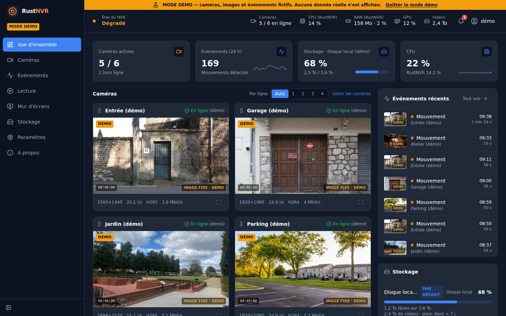
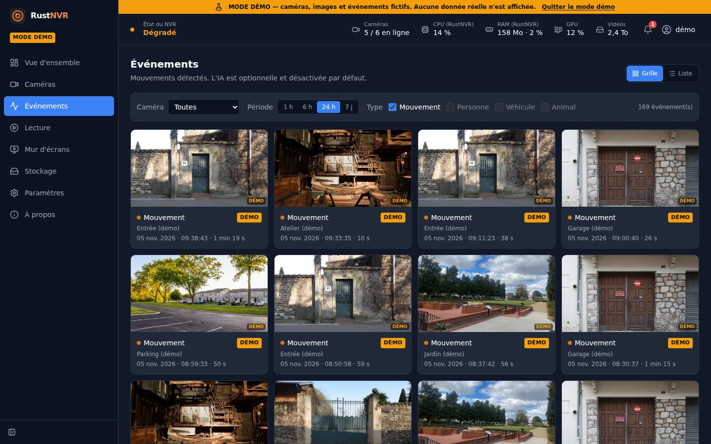
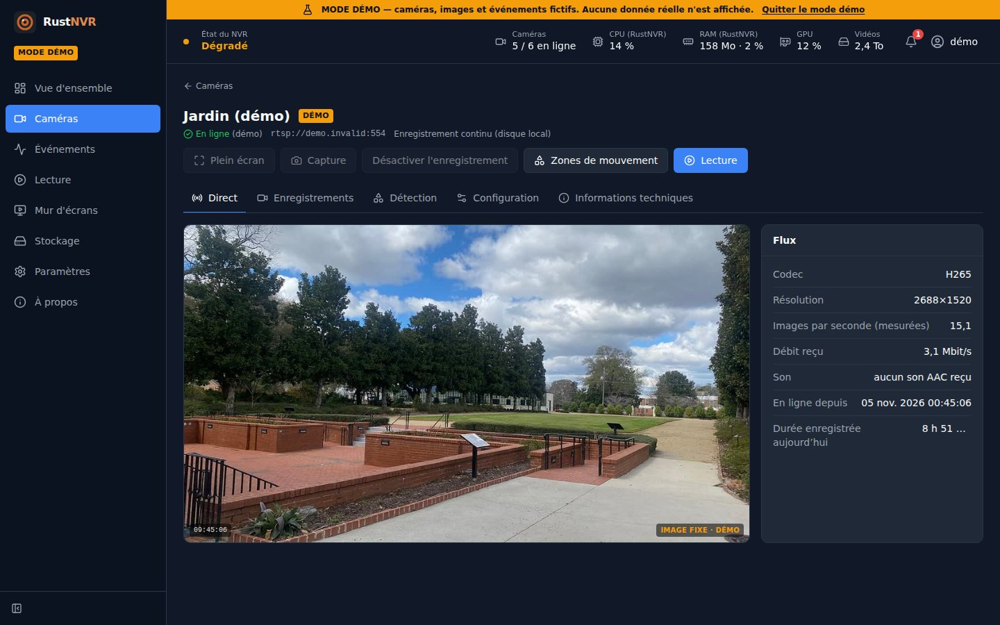

# RustNVR


Enregistreur vidéo réseau (NVR) open source en Rust, conçu pour une faible
consommation CPU/RAM : les flux H.264/H.265 des caméras IP sont reçus en RTSP
et enregistrés **sans décodage ni réencodage** dans des segments MP4 fragmentés.

> **État : enregistrement continu ou sur mouvement, interface Web, détection de mouvement et
> MQTT/Home Assistant.** Direct vidéo par WebSocket/MSE, ou WebRTC (expérimental,
> réseau local) ; enregistrement local
> et/ou NAS, S3, SFTP avec rétention ; détection de mouvement sans IA avec zones et
> événements ; MQTT avec découverte Home Assistant. Docker : voir
> [docs/DOCKER.md](docs/DOCKER.md).

Documents : **[Docker](docs/DOCKER.md)** · **[Installation (systemd)](docs/INSTALLATION.md)** ·
**[Home Assistant](docs/HOME_ASSISTANT.md)** · [MQTT](docs/MQTT.md) · [IA](docs/AI.md) ·
[ARCHITECTURE.md](ARCHITECTURE.md) · [FRONTEND.md](FRONTEND.md) ·
[API_CONTRACT.md](API_CONTRACT.md) ·
[ADR 0001 (RTSP, conteneur, WebRTC, MQTT)](docs/adr/0001-choix-techniques-fondamentaux.md)

## Aperçu

Captures du mode démo (`/?demo=1`) : caméras et événements fictifs, illustrés
par des photos libres de droits ([crédits](web/public/demo/CREDITS.md)).



| Événements | Une caméra |
|---|---|
|  |  |

## Fonctionnalités disponibles

- Caméras déclarées dans un fichier TOML validé au démarrage (toutes les
  erreurs listées en une fois, clés inconnues refusées).
- Client RTSP [Retina](https://crates.io/crates/retina) : TCP (défaut) ou UDP
  (expérimental), H.264 et H.265, authentification Basic (testée) et Digest
  (fournie par Retina, pas encore testée).
- Une supervision par caméra : délais d'attente, détection de flux bloqué,
  reconnexion avec backoff exponentiel et gigue.
- Enregistrement continu en fMP4 (`avc1`/`hvc1`), segments coupés sur image
  clé, nouveaux segments sur changement de paramètres, reconnexion, perte
  d'images ou saut d'horodatage.
- Écriture sûre : `.mp4.part` → `fsync` → renommage ; récupération
  automatique au démarrage (troncature au dernier fragment complet).
- Erreurs d'écriture (disque plein) : segment sauvé jusqu'au dernier fragment
  complet, reprise différée.
- Commandes `probe` (test de connexion), `check-config`, `recover`.
- Ajout, modification et suppression de caméras depuis l'interface Web, sans
  redémarrage, avec test de connexion. Elles sont stockées dans
  `cameras.ui.toml` (à côté de `config.toml`, lisible par son seul propriétaire,
  car il contient les mots de passe des caméras) ; les caméras de `config.toml`
  restent modifiables uniquement dans ce fichier. Une caméra ajoutée depuis
  l'interface n'enregistre pas par défaut.
- Points de stockage : chaque caméra enregistre sur le disque local et/ou sur
  un partage NAS (SMB/CIFS, NFS) monté dans le système, écrit directement.
  Contrôle que le partage est bien monté (sinon le disque système se
  remplirait) et repli automatique sur le disque local pendant une panne du
  NAS. Rétention par point de stockage (durée en jours, taille maximale),
  appliquée toutes les 10 minutes. Gérés dans Paramètres → Stockage
  (`storage.ui.toml`) ou dans `config.toml`.
- Relecture HLS : les segments qui se suivent sont lus sans pause (hls.js, HLS
  natif sur Safari), synchronisation de plusieurs caméras, vitesses ×1 à ×8.
- Interface Web (React) servie par RustNVR : vue d'ensemble, caméras et état
  RTSP, lecture des enregistrements avec timeline, stockage, paramètres ; mode
  démo isolé, direct vidéo sans réencodage (≈ 0,5 s de latence mesurée en
  local) ; option « Faible latence » par WebRTC (prototype, H.264, réseau
  local uniquement : 0,3 à 0,7 s d'avance sur le direct standard mesurées). Les fonctions indisponibles sur le serveur sont
  affichées comme « non disponibles ».
- Détection de mouvement sans IA, activée caméra par caméra (onglet
  « Détection ») : FFmpeg décode le sous-flux en petites images grises
  (320 px, 5 images/s), comparées à un fond adaptatif ; zones polygonales avec
  sensibilité par zone, changements d'éclairage ignorés. Événements en base
  SQLite avec vignette, page Événements, timeline, captures JPEG à la demande.
  Coût mesuré : 2,4 % d'un cœur pour FFmpeg sur un sous-flux H.265 768×432.
- IA optionnelle, désactivée par défaut et sans modèle fourni : l'image de
  chaque événement est analysée par un modèle YOLOX exécuté par RustNVR
  (31 ms par image, sans autre programme) ou envoyée à un serveur DeepStack /
  CodeProject.AI
  (objets reconnus dans l'API, MQTT et l'interface) ; testé contre un serveur
  simulé seulement ([docs/AI.md](docs/AI.md)).
- Stockage S3 (Amazon, MinIO, Backblaze, Wasabi…) et SFTP : les segments
  sont écrits dans un dossier d'attente local puis envoyés un par un
  (reprise automatique après une coupure, rien n'est perdu au redémarrage) ;
  clé du serveur SFTP vérifiée (empreinte fixée ou retenue à la première
  connexion).
- Son des caméras (AAC) enregistré avec la vidéo, sans conversion, désactivable
  par caméra (interface, MQTT / Home Assistant) ; bouton son dans la relecture
  et dans le direct de la page caméra (pas dans le direct WebRTC).
- Enregistrement au choix par caméra : en continu, ou seulement sur mouvement
  (5 s avant, depuis l'image clé précédente, et 5 s après chaque événement par
  défaut ; images d'avant gardées en mémoire, 32 Mio au plus).
- MQTT et découverte Home Assistant, configurables dans Paramètres → MQTT :
  mouvement, connexion, enregistrement, interrupteur de détection, image du
  dernier mouvement par caméra ([docs/MQTT.md](docs/MQTT.md)).
- API REST `/api/v1` et WebSocket temps réel
  ([API_CONTRACT.md](API_CONTRACT.md)) ; comptes administrateur / lecteur avec
  page de connexion (mots de passe Argon2, sessions par cookie, blocage après
  5 essais manqués), HTTP Basic pour les scripts.
- Journaux `tracing` texte ou JSON ; métriques périodiques par caméra
  (i/s, débit, pertes, reconnexions) et processus (CPU, RSS).
- Aucun secret journalisé : identifiants retirés de l'URL, URL affichées sous
  la forme `rtsp://hôte:port`, mots de passe possibles par variable
  d'environnement.

## Construire

Prérequis vérifiés : Linux x86_64 (testé sous Ubuntu 26.04 / WSL2), Rust
stable (testé avec 1.99.1), un compilateur C (`gcc`) pour l'édition de liens.
Aucune bibliothèque système n'est requise (pas d'OpenSSL ; l'enregistrement
n'utilise pas FFmpeg). **FFmpeg est optionnel** : détection de mouvement, captures,
vignettes d'événements, et conversion du direct en H.264 pour les navigateurs
qui ne décodent pas le H.265 (Firefox).
Pour l'interface : Node.js 24 et npm (testé avec 24.19 / 11.17).

```sh
cargo build --release              # binaire : target/release/rustnvr
cd web && npm ci && npm run build  # interface : web/dist
```

## Utiliser

Installation comme service sur un serveur : [docs/INSTALLATION.md](docs/INSTALLATION.md).
Essai rapide depuis le dépôt :

```sh
cp config.example.toml config.toml        # puis adapter les caméras
export RUSTNVR_ENTREE_PASSWORD='...'      # si password_env est utilisé
./target/release/rustnvr check-config -c config.toml
./target/release/rustnvr run -c config.toml
```

`run` s'arrête proprement sur `SIGINT`/`SIGTERM` : les segments ouverts sont
terminés et renommés avant la sortie.

### Interface Web

Lancez `rustnvr run` depuis la racine du dépôt (ou réglez `web.static_dir`)
puis ouvrez `http://127.0.0.1:8080`. Par défaut, l'interface n'écoute que sur
la machine locale. Pour y accéder depuis le réseau, activez l'authentification
(`web.username` + `web.password_env`) et changez `web.listen` (par exemple
`0.0.0.0:8080`) ; sans authentification, RustNVR refuse de démarrer sur une
adresse réseau. Activez aussi HTTPS (`web.tls_self_signed = true`, ou votre
certificat avec `web.tls_cert` / `web.tls_key`) : sinon les mots de passe et la
vidéo circulent en clair sur le réseau. Ajoutez `?demo=1` à
l'URL pour voir l'interface avec des données fictives. Détails :
[FRONTEND.md](FRONTEND.md).

Tester une caméra avant de l'ajouter (le mot de passe est lu dans une variable
d'environnement pour ne pas apparaître dans l'historique du shell) :

```sh
export CAM_PW='...'
./target/release/rustnvr probe --url rtsp://192.168.1.20/stream1 --username admin --password-env CAM_PW
# ou une caméra déjà configurée :
./target/release/rustnvr probe --camera entree -c config.toml
```

Exemple de sortie réelle (contre le serveur d'interopérabilité ci-dessous) :

```
probing rtsp://127.0.0.1:8554
* stream 0: video/h265 clock 90000 Hz 25 fps
  server tool: "GStreamer"
OK: h265 (hvc1.1.6.L93.90) 1280x720, first key frame after 42 ms
```

Réparer manuellement des segments interrompus (fait aussi au démarrage) :

```sh
./target/release/rustnvr recover --dir /var/lib/rustnvr/recordings
```

Journaux : niveau via `RUST_LOG` (par défaut `info`, ex. `RUST_LOG=debug`),
format JSON via `--log-format json`.

## Fichiers produits

```
<recordings_dir>/<camera>/<AAAA-MM-JJ>/<AAAAMMJJTHHMMSS.mmmZ>.mp4
```

Horodatage UTC du début du segment. Les fichiers sont décodés sans erreur par
FFmpeg (vérifié avec `ffprobe -count_frames`) et exportables sans réencodage :
`ffmpeg -i segment.mp4 -c copy export.mp4`. Depuis l'interface, le bouton
« Exporter » de la page Lecture fait un seul MP4 d'une période choisie (copié
tel quel, ou converti en H.264 pour un lecteur sans H.265). La lecture dans le navigateur est
vérifiée dans Edge pour le H.264 (page Lecture) ; Edge sur la machine de test
ne décode pas le H.265.

## Tests

```sh
cargo fmt --all --check
cargo clippy --workspace --all-targets -- -D warnings
cargo test --workspace
cd web && npm run build   # inclut la vérification TypeScript
```

Les tests incluent un serveur RTSP factice (`crates/rustnvr-testkit`) servant
de vrais flux H.264/H.265 (fixtures de 80 Ko régénérables par
`scripts/gen-fixtures.sh`, nécessite ffmpeg avec libx264/libx265) :
reconnexion, flux bloqué, authentification, et test de bout en bout jusqu'aux
fichiers. Si `ffprobe` est installé, les tests de bout en bout décodent chaque
segment et exigent zéro erreur ; sinon cette vérification est ignorée (un
message l'indique).

### Interopérabilité avec un serveur RTSP indépendant

`scripts/interop-gst-rtsp-server.py` sert une mire H.264 et H.265 avec
GStreamer (Ubuntu : `apt install python3-gi gir1.2-gst-rtsp-server-1.0
gstreamer1.0-plugins-good gstreamer1.0-plugins-bad gstreamer1.0-plugins-ugly`) :

```sh
python3 scripts/interop-gst-rtsp-server.py --width 1920 --height 1080 --fps 25 --bitrate 4000
./target/release/rustnvr probe --url rtsp://127.0.0.1:8554/h264
```

## Mesures

Relevés réels, chacun sur une seule installation : des ordres de grandeur, pas
un banc d'essai.

**Face à Frigate, à travail égal.** Même machine virtuelle Debian, mêmes
caméras réelles, 4 caméras en ligne de chaque côté ; enregistrement, détection
de mouvement et reconnaissance d'objets activés partout (RustNVR : YOLOX-s
intégré). Relevé `docker stats` (100 % = un cœur) :

| | Mémoire | Processeur |
|---|---|---|
| RustNVR | 162 Mio | 16 % |
| Frigate | 2,17 Gio | 45 % |

Soit environ 13 fois moins de mémoire et 2,7 fois moins de processeur. C'est
un relevé instantané : l'IA de RustNVR ne travaille que pendant les mouvements,
et une moyenne sur 24 h reste à faire.

**Enregistrement seul.** 4 flux 1080p à 25 images/s et 4 Mbit/s (2 en H.264,
2 en H.265, servis par GStreamer), Intel Core i5-11600K sous WSL2 : 1,8 à
2,1 % d'un cœur et 12 Mio de mémoire pour RustNVR, aucune image perdue,
segments décodés sans erreur par `ffprobe`.

**Autres coûts**

- Détection de mouvement : 2,4 % d'un cœur (FFmpeg) par sous-flux H.265
  768×432.
- Reconnaissance d'objets intégrée, sur un cœur de processeur de bureau :
  ≈ 38 ms par image avec YOLOX-nano, ≈ 413 ms avec YOLOX-s.
- Conversion H.265 → H.264 d'un enregistrement 1080p de 30 s (relecture dans
  un navigateur sans H.265) : 20,8 s de processeur avec libx264, 5,7 s avec
  une carte NVIDIA (NVENC).

## Limites connues

- Son : AAC seulement (les caméras G.711 sont enregistrées sans son) ; pas de
  son dans le direct WebRTC.
- Images B / horodatages non monotones : le segment est coupé (pas de
  réordonnancement).
- `rtsps://` non supporté (limite du client RTSP).
- Rétention par point de stockage et par caméra (âge, taille). L'index SQLite
  des enregistrements se reconstruit depuis les fichiers (au démarrage, puis
  toutes les 10 min) : un fichier copié à la main apparaît avec ce délai.
- Détection de mouvement : nécessite FFmpeg ; un événement continue ≈ 1 s
  après la sortie d'un objet (le fond se réadapte) ; un objet qui s'immobilise
  cesse d'être détecté après ≈ 1 s ; ombres,
  feuillage et pluie peuvent déclencher : réglez la sensibilité et les zones.
  Un événement en cours lors d'un arrêt brutal est clos à sa date de début.
- Stockage distant : NAS (écriture directe) ; S3 et SFTP par envoi des
  segments terminés (une minute de décalage avec des segments de 60 s), sans
  relecture depuis le distant ni rétention côté distant (utilisez les règles
  de cycle de vie du bucket, ou un nettoyage sur le serveur SFTP). Le segment
  en cours lors d'une panne du NAS est perdu.
- Direct WebRTC : prototype, sans STUN/TURN : il faut un chemin UDP direct
  entre le navigateur et le serveur (réseau local ou VPN) ; une caméra H.265
  passe par la conversion H.264 (FFmpeg). Testé seulement dans Edge.
- Interface : le direct
  H.265 et sa relecture sont convertis en H.264 si le navigateur ne décode pas
  le H.265 (FFmpeg ; quelques secondes d'attente par fichier relu, image
  réduite à 1280 px de large) ; pas de direct sur iPhone (la
  relecture HLS y est prévue mais non testée) ;
  réseau (adresse, HTTPS) et caméras de config.toml modifiables uniquement dans
  `config.toml`. Une coupure entre deux segments (reconnexion, enregistrement
  sur mouvement) reste visible : le lecteur saute au bloc suivant.

## Licence

Au choix : [MIT](LICENSE-MIT) ou [Apache 2.0](LICENSE-APACHE).

Sauf mention contraire, toute contribution proposée pour être incluse dans
RustNVR est placée sous ces deux licences, sans condition supplémentaire.
